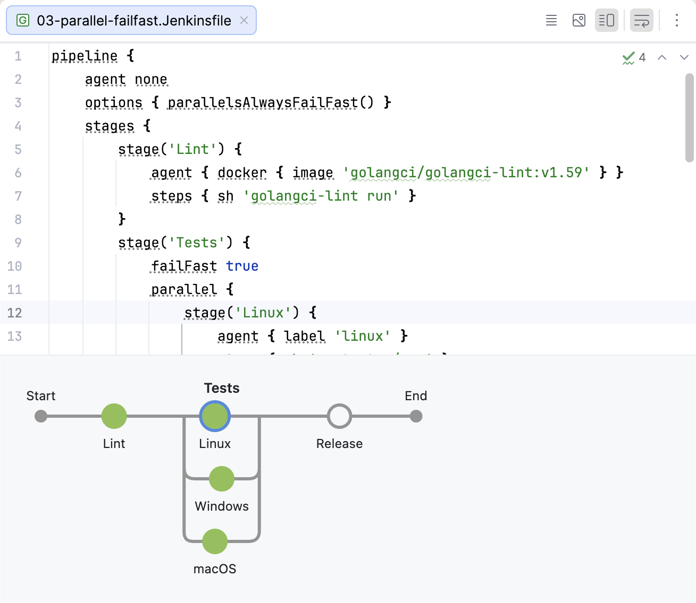

# Jenkinsfile Visualizer

**[▶ Try it in your browser](https://varad.github.io/jenkins-ppln-visual/)**, no install needed.

Reads a Jenkins **declarative** pipeline (`pipeline { ... }`) and draws its stages:
sequential, `parallel`, nested `stages`, `matrix` (expanded into cells), `when`,
`input`, `agent` and `post`. Everything runs in the browser; files never leave
your machine.

## Quick start

Open `packages/web/dist/index.html` straight from disk (it is one self-contained
file), or run the dev server:

```sh
pnpm install
pnpm dev          # http://localhost:5173
pnpm test         # parser + layout tests over every sample in fixtures/
pnpm build        # rebuilds packages/web/dist/index.html
```

Then paste a Jenkinsfile, use **Open file…**, drag one onto the window, or pick
a bundled sample. Click a stage to see its details and jump to its source;
click in the source to select the stage. **Copy Mermaid** gives a diagram you
can paste into GitHub Markdown; **Download SVG** saves the picture.

## Layout

| Path | What |
| --- | --- |
| `packages/core` | Host-agnostic TypeScript: Groovy-aware lexer, tolerant block parser, declarative interpreter with validation, graph builder, rail layout, Mermaid and SVG export |
| `packages/web` | React viewer: CodeMirror editor, SVG preview, details panel. Builds to a single HTML file, plus the diagram-only page the IDE plugins embed |
| `packages/intellij` | IntelliJ plugin (Kotlin, JCEF) |
| `packages/vscode` | VS Code extension (TypeScript, webview) |
| `fixtures/handwritten` | Samples covering every declarative feature plus edge cases (Groovy string traps, scripted pipeline, missing brace) |
| `fixtures/public` | Real Jenkinsfiles from jenkinsci/jenkins (scripted), apache/camel, apache/maven, apache/zookeeper (Apache-2.0) and jenkinsci/pipeline-model-definition-plugin tests (MIT) |

## What is and isn't known statically

- `when` conditions, `input` and `script { }` blocks are shown, never evaluated.
- Interpolated stage names (`stage("Deploy ${env.X}")`) are shown as written.
- Scripted pipelines (`node { ... }`) are detected and reported, not drawn.
- With a missing `}`, the parser recovers using indentation and still draws the stages.

## IntelliJ plugin

`packages/intellij` adds **Code**, **View** and **Dual** icons above the editor for
`Jenkinsfile`, `*.Jenkinsfile` and `Jenkinsfile.*`. It targets IntelliJ 2026.3 and
needs `pnpm install` to have been run.



```sh
cd packages/intellij
./gradlew runIde        # try it in a sandbox IDE
./gradlew buildPlugin   # build/distributions/*.zip, for Install Plugin from Disk
```

It shows `packages/web/embed.html`, a diagram-only page driven through
`window.jpvView.setSource(text)`, `window.jpvView.setTheme(dark, background)` and
`window.jpvView.setLocale(tag)`.
In Dual view, clicking a stage or the post node moves the caret to it in the code,
and placing the caret inside a stage in the code rings that stage in the diagram.

## VS Code extension

`packages/vscode` adds **Open Pipeline Preview** to the editor title bar for the same file names. It
shows the same `embed.html` in a webview under the code, using the full width like IntelliJ
(set `jenkinsfileVisualizer.previewPosition` to `beside` to put it on the right instead). As in IntelliJ's Dual view, clicking a stage moves the
caret to it, the caret rings its stage, and dragging, renaming or removing a stage edits the file (undo works).
The wrap button in the preview's title bar toggles wrapping.

```sh
pnpm --filter jenkinsfile-visualizer package   # packages/vscode/dist/*.vsix, for Extensions: Install from VSIX…
```

To try it from source, open the repo in VS Code and run **Run VS Code extension** (F5).
`packages/web/src/vscodeBridge.ts` turns webview messages into the `window.jpvView` / `window.jpvHost` calls
described below. It does nothing outside VS Code.

## Host bridge (for IDE plugins)

The page exposes `window.jpv.setSource(text)` and calls
`window.jpvHost.onSelect(range)` when a stage or step is clicked, so an
IntelliJ (JCEF) or VS Code webview can drive it.

## Languages

The viewer, the diagram, the parser's messages and both IDE plugins are available in English, Czech,
Danish, Finnish, French, German, Norwegian (Bokmål), Polish, Slovak, Spanish and Swedish.
The web app follows the browser's language. You can override it with the picker in the toolbar or with
`?lang=de`. VS Code follows its display language. IntelliJ follows its language pack, or the operating
system's language when the IDE is in English. Unsupported languages fall back to English.
Jenkins syntax such as `steps`, `parallel`, `when` and `post` is never translated.

The translations were drafted by machine and need review by native speakers. Corrections are welcome.

To add a language:

1. Copy `packages/core/src/i18n/en.ts` to `<code>.ts`, translate it, and list it in `CATALOGS` and
   `LOCALES` in `packages/core/src/i18n/index.ts`. A plural message needs every form its language uses
   (`one`, `few`, `many`, `other`), and `pnpm test` checks this along with the keys and placeholders.
2. VS Code: add `packages/vscode/package.nls.<code>.json` and `packages/vscode/l10n/bundle.l10n.<code>.json`.
3. IntelliJ: add `packages/intellij/src/main/resources/messages/JpvBundle_<code>.properties`.
