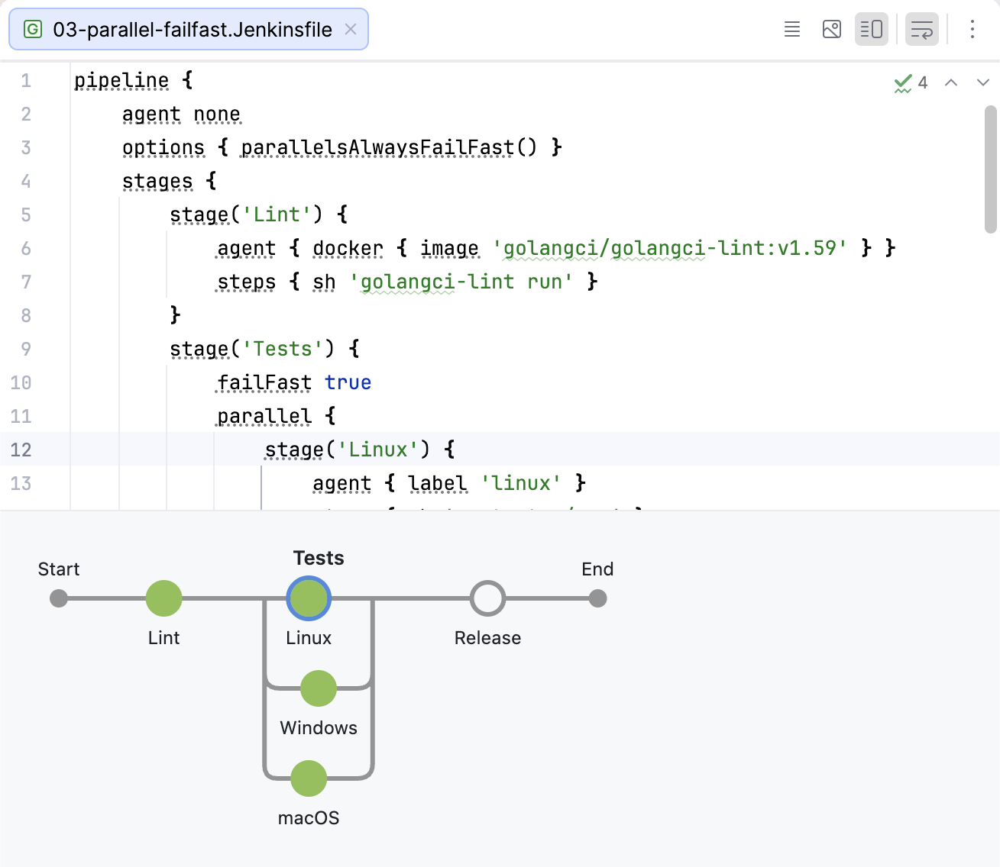

# Jenkinsfile Visualizer

**[▶ Try it in your browser](https://varad.github.io/jenkins-ppln-visual/)**, no install needed.

Reads a Jenkins **declarative** pipeline (`pipeline { ... }`) and draws its stages:
sequential, `parallel`, nested `stages`, `matrix` (expanded into cells), `when`,
`input`, `agent` and `post`. Everything runs in the browser; files never leave
your machine.

## Quick start

Open `packages/web/dist/index.html` straight from disk (it is one self-contained
file), or run the dev server:

```sh
pnpm install
pnpm dev          # http://localhost:5173
pnpm test         # parser + layout tests over every sample in fixtures/
pnpm build        # rebuilds packages/web/dist/index.html
```

Then paste a Jenkinsfile, use **Open file…**, drag one onto the window, or pick
a bundled sample. Click a stage to see its details and jump to its source;
click in the source to select the stage. **Copy Mermaid** gives a diagram you
can paste into GitHub Markdown; **Download SVG** saves the picture.

## Layout

| Path | What |
| --- | --- |
| `packages/core` | Host-agnostic TypeScript: Groovy-aware lexer, tolerant block parser, declarative interpreter with validation, graph builder, rail layout, Mermaid and SVG export |
| `packages/web` | React viewer: CodeMirror editor, SVG preview, details panel. Builds to a single HTML file (also the future IntelliJ/VS Code webview) |
| `fixtures/handwritten` | Samples covering every declarative feature plus edge cases (Groovy string traps, scripted pipeline, missing brace) |
| `fixtures/public` | Real Jenkinsfiles from jenkinsci/jenkins (scripted), apache/camel, apache/maven, apache/zookeeper (Apache-2.0) and jenkinsci/pipeline-model-definition-plugin tests (MIT) |

## What is and isn't known statically

- `when` conditions, `input` and `script { }` blocks are shown, never evaluated.
- Interpolated stage names (`stage("Deploy ${env.X}")`) are shown as written.
- Scripted pipelines (`node { ... }`) are detected and reported, not drawn.
- With a missing `}`, the parser recovers using indentation and still draws the stages.

## IntelliJ plugin

`packages/intellij` adds **Code**, **View** and **Dual** icons above the editor for
`Jenkinsfile`, `*.Jenkinsfile` and `Jenkinsfile.*`. It targets IntelliJ 2026.3 and
needs `pnpm install` to have been run.



```sh
cd packages/intellij
./gradlew runIde        # try it in a sandbox IDE
./gradlew buildPlugin   # build/distributions/*.zip, for Install Plugin from Disk
```

It shows `packages/web/embed.html`, a diagram-only page driven through
`window.jpvView.setSource(text)` and `window.jpvView.setTheme(dark, background)`.
In Dual view, clicking a stage or the post node moves the caret to it in the code,
and placing the caret inside a stage in the code rings that stage in the diagram.

## Host bridge (for IDE plugins)

The page exposes `window.jpv.setSource(text)` and calls
`window.jpvHost.onSelect(range)` when a stage or step is clicked, so an
IntelliJ (JCEF) or VS Code webview can drive it.
